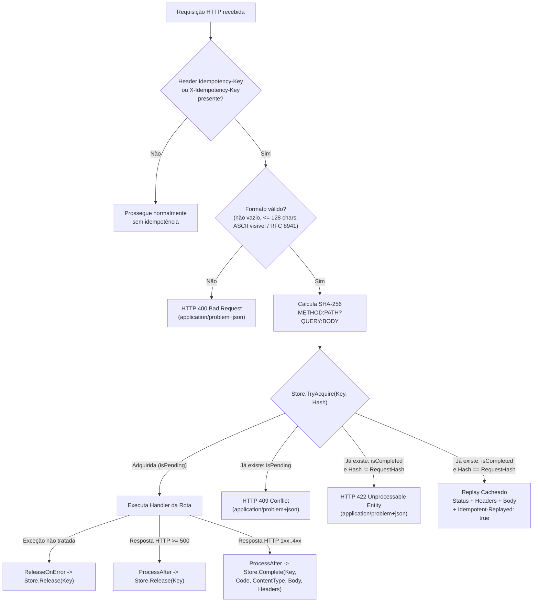

# RFC: Middleware Nativo de Idempotência no Zenith (`Idempotency-Key`)

> **Especificação de Referência**: IETF Draft [`draft-ietf-httpapi-idempotency-key-header`](https://datatracker.ietf.org/doc/draft-ietf-httpapi-idempotency-key-header/) + RFC 9457 (*Problem Details for HTTP APIs*) + RFC 8941 (*Structured Field Values*).  
> **Unit**: `src/Zenith.Idempotency.pas` (symlink case-safe: `src/zenith.idempotency.pas`).  
> **Escopo**: 100% agnóstico de domínio, zero dependências externas além da RTL/FCL do Free Pascal.

---

## 1. Motivação e Visão Geral

Em operações HTTP não-idempotentes (como `POST /api/orders` ou `POST /api/payments`), falhas de rede, timeouts ou *retries* automáticos de clientes podem duplicar efeitos colaterais (pedidos duplicados, cobranças em dobro).

O middleware nativo `Zenith.Idempotency` resolve esse problema diretamente no ciclo de roteamento HTTP (`httproute.pas`), garantindo execução **no máximo uma vez** (*at-most-once*) para cada chave `Idempotency-Key` dentro da janela de retenção (TTL), com:

- **Store LRU O(1) Thread-Safe** (`TZenithMemoryIdempotencyStore`) baseado em tabela hash encadeada nativa + lista duplamente encadeada LRU + expiração monotônica (`GetTickCount64`).
- **Fingerprint criptográfico SHA-256** sobre método HTTP, caminho/query e payload completo.
- **Proteção contra concorrência real** (*in-flight lock*): retorna **HTTP 409 Conflict** (RFC 9457) quando duas requisições simultâneas usam a mesma chave.
- **Proteção contra mutação de payload**: retorna **HTTP 422 Unprocessable Entity** (RFC 9457) quando a mesma chave é reutilizada com payload, rota ou método diferente.
- **Replay fiel**: devolve status HTTP, cabeçalhos originais (`Location`, `ETag`, `Cache-Control`, headers customizados), `Content-Type` e corpo cacheados acrescidos do cabeçalho `Idempotent-Replayed: true`.
- **Resiliência a falhas transitórias**: respostas `HTTP 5xx` ou exceções não tratadas liberam automaticamente a chave para permitir *retry* imediato pelo cliente.

---

## 2. Fluxo de Execução (Máquina de Estados)



---

## 3. Contrato HTTP e Cabeçalhos

### 3.1 Cabeçalhos de Requisição

| Cabeçalho | Obrigatório | Formato | Descrição |
|---|---|---|---|
| `Idempotency-Key` | Opcional | Token ASCII visível (`0x21..0x7E`) ou *Structured Field String* (`"..."` RFC 8941), máx. `128` chars | Chave única gerada pelo cliente (recomendado UUID v4 ou ULID). |
| `X-Idempotency-Key` | Alias opcional | Mesmo formato acima | Alias aceito para retrocompatibilidade com clientes legados. |

### 3.2 Cabeçalhos de Resposta

| Cabeçalho | Quando presente | Valor | Descrição |
|---|---|---|---|
| `Idempotent-Replayed` | Apenas em respostas de replay | `true` | Indica explicitamente ao cliente que a resposta foi servida a partir do cache de idempotência. |
| Headers originais | Em respostas de replay | Valores originais | `Location`, `ETag`, `Cache-Control` e headers customizados (ex: `X-Order-Id`) são preservados. Headers *hop-by-hop* (`Connection`, `Transfer-Encoding`, `Content-Length`, `Content-Encoding`, `Date`) não são duplicados. |

### 3.3 Códigos de Erro (RFC 9457 — `application/problem+json`)

| HTTP Status | Condição | Exemplo de Payload |
|---|---|---|
| `400 Bad Request` | Cabeçalho presente porém vazio, acima de `MaxKeyLength` (128), com aspas malformadas ou caracteres de controle/espaços. | `{"type":"https://tools.ietf.org/html/rfc9457","title":"Bad Request","status":400,"detail":"Idempotency-Key exceeds maximum allowed length of 128 characters.","instance":"/api/orders"}` |
| `409 Conflict` | Outra requisição com a mesma chave ainda está em processamento (`isPending`). | `{"type":"https://tools.ietf.org/html/rfc9457","title":"Conflict","status":409,"detail":"A request with the Idempotency-Key 'ord-01' is currently in progress.","instance":"/api/orders"}` |
| `422 Unprocessable Entity` | A chave já foi concluída, mas o hash SHA-256 (`METHOD:PATH?QUERY:BODY`) diverge da requisição original. | `{"type":"https://tools.ietf.org/html/rfc9457","title":"Unprocessable Entity","status":422,"detail":"Idempotency-Key 'ord-01' payload or target mismatch with original request.","instance":"/api/orders"}` |

---

## 4. Arquitetura do Store LRU O(1) Thread-Safe

O `TZenithMemoryIdempotencyStore` implementa a interface `IZenithIdempotencyStore` combinando duas estruturas em memória protegidas por `TCriticalSection`:

1. **Tabela Hash Encadeada Nativa (`FBuckets`)**:
   - Função hash FNV-1a 32-bit com máscara de potência de 2 (`KeyHash and FMask`).
   - Rehash automático quando o fator de carga excede `2.0` (até 1.048.576 buckets).
   - Busca, inserção e remoção em **O(1)** amortizado, sem alocação de wrappers extras.
2. **Lista Duplamente Encadeada LRU (`FHead` / `FTail`)**:
   - `FHead` aponta para o registro mais recentemente acessado (MRU).
   - `FTail` aponta para o registro menos recentemente acessado (LRU).
   - Ao atingir `Capacity`, o nó em `FTail` é removido em **O(1)** (`EvictTail`).
3. **Expiração Monotônica por TTL**:
   - Cada nó registra `CreatedTick := GetTickCount64`, imune a saltos de relógio NTP.
   - Expiração verificada em **O(1)** na leitura (`TryAcquire`/`Get`) e na cauda LRU antes da evicção, além de limpeza sob demanda via `PurgeExpired`.

### Interface `IZenithIdempotencyStore`

```pascal
IZenithIdempotencyStore = interface
  ['{A6B9C184-7F89-4D2A-9289-EC8E0A9D8210}']
  function TryAcquire(const AKey, ARequestHash: string;
    out AExisting: TIdempotencyRecord;
    out AIsConflict: Boolean;
    out AIsPayloadMismatch: Boolean): Boolean;
  procedure Complete(const AKey: string; ACode: Integer;
    const AContentType: string; const ABody: RawByteString); overload;
  procedure Complete(const AKey: string; ACode: Integer;
    const AContentType: string; const ABody: RawByteString;
    const AHeaders: TIdempotencyHeaderArray); overload;
  procedure Release(const AKey: string);
  function Get(const AKey: string; out ARecord: TIdempotencyRecord): Boolean;
  function PurgeExpired: Integer;
  procedure Clear;
  function Count: Integer;
  function GetStats: TIdempotencyStoreStats;
  property Capacity: Integer read GetCapacity write SetCapacity;
  property TTLSeconds: Integer read GetTTLSeconds write SetTTLSeconds;
end;
```

Qualquer backend distribuído (ex: Redis, PostgreSQL, Valkey) pode ser plugado implementando `IZenithIdempotencyStore` e atribuindo `TZenithIdempotency.DefaultStore := MeuStoreDistribuido;`.

---

## 5. Exemplos de Uso

### 5.1 Configuração no Servidor Zenith

```pascal
uses
  Zenith.App, Zenith.Idempotency;

begin
  { Configuração opcional: capacidade 50.000 chaves, TTL de 24 horas }
  TZenithIdempotency.DefaultStore := TZenithMemoryIdempotencyStore.Create(50000, 86400);
  TZenithIdempotency.MaxKeyLength := 128;
  TZenithIdempotency.Enabled := True;

  ZenithApp
    .SetTitle('Order & Payment API')
    .SetPort(8080)
    .Run;
end.
```

### 5.2 Exemplo de Chamada HTTP (`TOrder` / `TPayment`)

**1ª Requisição (criação de pedido):**
```http
POST /api/orders HTTP/1.1
Host: api.example.com
Content-Type: application/json
Idempotency-Key: "8e03978e-40d5-43e8-bc93-6894a57f9324"

{"customer":"Alice","items":[{"sku":"ITEM-01","qty":2}],"total":150.00}
```

**Resposta Original:**
```http
HTTP/1.1 201 Created
Content-Type: application/json; charset=utf-8
Location: /api/orders/ORD-42
X-Order-Id: ORD-42

{"orderId":"ORD-42","status":"created","total":150.00}
```

**2ª Requisição (retry após queda de rede com a mesma chave e payload):**
```http
HTTP/1.1 201 Created
Content-Type: application/json; charset=utf-8
Location: /api/orders/ORD-42
X-Order-Id: ORD-42
Idempotent-Replayed: true

{"orderId":"ORD-42","status":"created","total":150.00}
```

**3ª Requisição (mesma chave com valor alterado — anti-replay / proteção contra corrupção):**
```http
HTTP/1.1 422 Unprocessable Entity
Content-Type: application/problem+json; charset=utf-8

{"type":"https://tools.ietf.org/html/rfc9457","title":"Unprocessable Entity","status":422,"detail":"Idempotency-Key '8e03978e-40d5-43e8-bc93-6894a57f9324' payload or target mismatch with original request.","instance":"/api/orders"}
```

---

## 6. Observabilidade e Métricas

O método `GetStats: TIdempotencyStoreStats` expõe contadores atômicos em tempo real:

- `ActiveCount`: número de chaves ativas no store.
- `Capacity` / `TTLSeconds`: limites configurados.
- `Hits`: total de replays servidos do cache.
- `Misses`: total de novas chaves adquiridas.
- `Conflicts`: total de rejeições `409 Conflict` por concorrência *in-flight*.
- `PayloadMismatches`: total de rejeições `422 Unprocessable Entity` por divergência de SHA-256.
- `Evictions`: total de expulsões por política LRU.
- `Expirations`: total de chaves expiradas por TTL.
